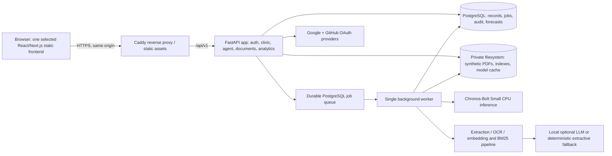

# Agentic Clinic: Backend Architecture, Oracle Cloud Setup and Development Plan

**Version:** 30 October 2026 · **Status:** Design and planning, not an implementation claim  
**Purpose:** Instructor review, implementation guide, task tracker, and deployment handoff.  
**Chosen forecasting foundation model:** `amazon/chronos-bolt-small` (Apache 2.0).  
**Deployment target:** Oracle Cloud Infrastructure (OCI), Always Free resources only where the tenancy confirms eligibility.  
**Budget:** ₹0 target. No paid service, upgrade, trial-only resource, payment method, or unexpected cost without explicit owner approval.  
**Prototype boundary:** Fictional/synthetic data only; no diagnosis, prescribing, emergency care, or production healthcare-compliance claim.

> **Current reality:** The published Site and accompanying ZIP are browser-only mockups with fictional data. No FastAPI server, Oracle deployment, OAuth authentication, retrieval pipeline, or Chronos model is connected. The Sage, Pulse, and Terra designs are three alternatives, not three different backends. No record identifies which one was finally selected, so this handoff preserves all three; select one or specify the combination before frontend production work.

## 1. Project scope and feature inventory

### 1.1 Personas and privileges

| Role | Core tasks | Access boundary |
|---|---|---|
| Visitor | Read landing page and start login | No private data or booking actions |
| Patient | Find doctors, manage own appointments, upload/read own documents, use assistant | Only their own patient records and explicitly shared clinic guides |
| Doctor | View assigned schedule, appointment details needed for service; manage own availability if enabled | Only appointments assigned to that doctor within their clinic |
| Clinic administrator | Manage doctors and slots, see aggregate analytics, view limited audit events | Scope to their authorized clinic; no global access by default |
| Background worker | Ingest authorized documents and generate forecasts | Restricted service identity; only minimum database and storage permissions |

**Access is enforced server-side, on every object and every request.** The mockup role switch is a demonstration only and is not authentication or authorization.

### 1.2 Features and design surfaces

| Feature | Frontend surfaces | Backend responsibility | Delivery priority |
|---|---|---|---|
| Landing and login | Landing, Google/GitHub sign-in | OAuth/OIDC callbacks, secure session, logout | MVP |
| Overview | Patient overview, doctor schedule, clinic console | Role-scoped summaries and upcoming records | MVP |
| Doctors and slots | Search, specialty filters, slot picker | Doctor listing, date/doctor availability, time zones | MVP |
| Appointments | Booking, review, reschedule, cancel, status | Ownership, validation, transactional uniqueness, confirmations, audit | MVP |
| Controlled assistant | Chat, suggested actions, proposal and confirmation | Typed intents, authorized tools, proposal lifecycle, safe replies | MVP; deterministic first |
| Documents | Upload, processing, list, source preview, deletion | Validation, isolation, queued processing, ownership, lifecycle | MVP with local OCR fallback |
| Retrieval and answers | Questions, citations, unavailable/error states | BM25 + embeddings + fusion, scoped retrieval, bounded responses | MVP with extractive fallback |
| Insights | KPI cards, charts, definitions, filters and forecast chart | Aggregate SQL, cohort definitions, Chronos forecasts, evaluation | MVP for basic analytics + forecast |
| Audit | Recent actions / administrator audit | Append-only audit events with minimized metadata | MVP |
| Reminders | Preferences and reminder states | Scheduled jobs, durable status and idempotency | MVP simulated; email delivery only with verified free route |
| Settings/errors | Profile, logout, permissions, 403/404/errors | Session, safe errors, access checks | MVP |
| Future enhancements | No-show prediction, advanced optimization, multilingual support | Separate proposal, data and evaluation | Out of scope until approved |

**Design choice:** Sage emphasizes patient care; Pulse emphasizes clinic operations; Terra emphasizes a guided patient experience. All can call the same API. Accessibility, responsive layouts, clear control labels, reduced motion, keyboard navigation, skeletons, confirmation, and undo/feedback are shared. The shipped UI must label forecasts and synthetic content. Client undo does not replace a server-side authorization and transaction.

## 2. System architecture



### 2.1 Primary deployment topology

- One OCI Always Free-eligible Linux VM in the **home region**. Confirm the shape and remaining tenancy allocation in the OCI console; start with a small configuration and monitor memory. Oracle's current free-tier overview explicitly warns Always Free tenancies must be at or below **2 OCPUs and 12 GB total Ampere A1 memory before trial expiry**; eligibility and availability shown in the tenant are authoritative. Do not assume older 4-OCPU/24-GB posts still apply. If an eligible Arm instance is unavailable, use a verified eligible alternative or a local demo; do not buy capacity.
- HTTPS reverse proxy serves the static frontend and forwards `/api/v1` to FastAPI. One origin simplifies cookies, OAuth redirects, CORS, and CSRF policy. A publicly reachable HTTPS domain and DNS control are prerequisites for normal production certificate issuance and OAuth redirects; no free domain is assumed. If none exists, demonstrate locally on `localhost` and do not pretend an IP-only OAuth setup is complete.
- PostgreSQL and worker are private containers bound to the internal network, with persistent volumes. They are not publicly reachable. A minimal deployment can run the worker in a separate process on the same VM.
- File storage and model assets remain on a private persistent volume. This is a **single-VM academic prototype**, with downtime and data loss risk; encryption, tested backups, and restoration are mandatory. Keep synthetic data only.
- Build ARM64-compatible images and verify dependency wheels or builds on the chosen shape. If PyTorch, OCR, embedding, or database dependencies fail or memory is inadequate, postpone that component, run it locally, or switch to a verified compatible small alternative. Do not claim ARM compatibility until tested.
- OCI Always Free status is not a promise of indefinite availability. Capacity exhaustion, idle-instance reclamation, quota changes, and service expiry are operational risks. Do not manufacture activity to circumvent provider policies.

### 2.2 Boundary and data-flow rules

1. Browser input is untrusted; HTTPS terminates at the proxy. API authenticates the session and checks role and clinic/object ownership.
2. No direct browser access to PostgreSQL, model process, file storage, or worker. Only the proxy exposes ports 80/443; restrict SSH to the owner's IP or use a verified access method. OCI VCN security lists/NSGs and host firewall both apply.
3. Request schema and max sizes are validated before service execution. Authorization is repeated at tool and database-object boundaries.
4. An agent or retrieved document never gains authority by supplying text. Every mutation requires a server-issued proposal, explicit confirmation, current authorization, and database transaction.
5. Documents are untrusted input; isolate processing, validate signatures, and apply time, memory, page, and text-size limits. Authorized access filters are applied before text leaves storage.
6. Forecasting consumes aggregated synthetic counts, not raw patient information. The worker persists results and validation metadata. The UI reads the latest authorized forecast; inference is not run on the request thread.

## 3. Target stack and proposed repository

| Layer | Default | Fallback / constraint |
|---|---|---|
| UI | Existing mockup as reference; React + TypeScript + Next.js static export, Tailwind | Keep mock adapter until API exists; no secrets in browser |
| API | Python 3.11/3.12, FastAPI, Pydantic | Pin tested versions compatible with target Arm/x86 |
| Database | PostgreSQL; SQLAlchemy + Alembic | Local PostgreSQL via containers; SQLite only for limited isolated experiments, not concurrent booking verification |
| Authentication | Server-side Google OIDC and GitHub OAuth via a vetted client library; opaque server sessions | Development-only fake identity behind an explicit non-production flag |
| Proxy | Caddy with static frontend and `/api` reverse proxy | Nginx plus properly managed TLS; DNS required |
| Jobs | PostgreSQL-backed jobs table; one worker | A vetted PostgreSQL queue implementation; no paid broker |
| Files | Local private directory on persistent disk | S3-compatible OCI Object Storage only after separately verifying free allowance, access control, and backup |
| PDF/OCR | pypdf or PyMuPDF, Tesseract on bounded pages | Flag unreadable scan as failed; no paid OCR |
| Search | Lexical BM25 + small local embedding model + metadata-filtered vector index | Start extractive-only; choose FAISS or Qdrant after Arm, filtering, deletion and backup tests |
| Text generation | Deterministic extractive answer initially; optional local model via provider adapter | Return relevant snippets with citations and honest no-answer response when model unavailable |
| Forecasting | Chronos-Bolt Small, CPU; batch worker | Last-same-weekday forecast; explicit fallback and stale state |
| Monitoring | Structured logs, `/health/live`, `/health/ready`, local metrics | No raw patient information; no unverified paid telemetry |
| Containers / CI | Docker/Compose, pytest, frontend test runner, GitHub Actions within verified quota | Local commands if container installation or hosted CI unavailable |

```text
agentic-clinic/
  frontend/                # chosen Next.js static-export UI + typed client
  backend/
    app/
      api/v1/              # route handlers, schemas, dependencies
      core/                # settings, sessions, security, logging
      db/                  # models, session, migration support
      modules/
        auth/ clinics/ doctors/ appointments/ agents/
        documents/ retrieval/ analytics/ forecasts/ reminders/ audit/
      workers/             # queue consumer, ingestion, forecast jobs
      providers/           # embeddings, vector store, LLM, file storage
    migrations/            # Alembic
    tests/                 # unit, API, integration, security, evaluation
    scripts/               # synthetic seed, benchmark, backup verification
  infra/                   # Compose, Caddyfile, service configuration
  docs/                    # ADRs, API, threat model, runbooks, data dictionary
  datasets/synthetic/      # generated non-sensitive examples, seed and license
  .env.example             # placeholder-only values
```

## 4. Data design and integrity

Store timestamps as UTC `timestamptz`; display IST/clinic timezone in UI. Use stable UUIDs and explicit foreign keys. Never store raw provider OAuth tokens unless strictly necessary. Separate system-wide synthetic dataset used for analytics from each patient's session view.

| Entity | Required fields / important rules |
|---|---|
| `users` | id, email (nullable), display_name, created_at, active; only synthetic demo profiles |
| `oauth_identities` | user_id, provider, provider_subject; UNIQUE(provider, provider_subject); no automatic linking solely by email |
| `sessions` | id, user_id, hashed opaque token, expires_at, revoked_at, created_at |
| `clinics`, `memberships` | clinic id, timezone; user, clinic, role; UNIQUE user/clinic/role |
| `doctors` | user_id optional, clinic_id, fictional name, specialty, active |
| `availability_slots` | clinic_id, doctor_id, start/end UTC, state; prevent overlapping active slots per doctor |
| `appointments` | clinic_id, patient_id, doctor_id, slot_id, start/end, status, version, timestamps |
| `agent_proposals` | id, actor_id, clinic_id, action, canonical arguments, expiry, state, version, confirmation key |
| `documents` | id, owner, clinic, original safe display name, hash, type, size, status, storage key, created/deleted dates |
| `document_chunks` | document_id, chunk number, page, text reference, embedding/index version, access metadata |
| `jobs` | id, type, scoped payload, idempotency key, status, attempts, available_at, lease and error code |
| `reminders` | appointment_id, type, due_at, status, dedupe key; simulated by default |
| `audit_events` | actor, clinic, action, resource type/id, timestamp, outcome, correlation_id; safe metadata only |
| `forecast_runs` | as-of date, window, scope, model/version, dataset version/hash, status, quantiles, runtime, fallback flag |
| `forecast_evaluations` | cutoff, horizon, actuals, predictions, baseline, MAE, interval coverage, dataset/version |
| `idempotency_records` | actor, operation, idempotency key, request hash, result/status; UNIQUE actor/operation/key |

**Appointment concurrency:** In a database transaction, lock the slot row (`SELECT … FOR UPDATE`), verify active/available, patient and provider scope, times and conflicts, then insert/update and mark slot. Add a partial unique constraint to ensure only one active appointment per slot, plus exclusion constraints or equivalent for overlapping doctor intervals. Rescheduling atomically claims the new slot and releases the old slot. Return HTTP 409 for races. Tests must run against PostgreSQL with two competing requests. Idempotency keys belong to a user + operation + request hash; same key/different payload returns conflict, and retries return the original result. A browser-only button guard is not sufficient.

**Retention:** Synthetic documents, extracted text, vectors, logs, audit, session data and backups need written retention/deletion periods. Deleting a document must revoke retrieval immediately and remove its derived chunks, lexical entries, vectors, copies and backups according to the documented policy. Model caches must never contain user data.

## 5. API contracts (draft)

All paths prefixed `/api/v1`. Generate OpenAPI; responses include request IDs and predictable typed error objects. Use pagination, narrow fields and explicit scopes. All state-changing endpoints validate CSRF for cookie sessions, require authorization and apply idempotency as appropriate.

| Endpoint | Purpose | Authorization / key behavior |
|---|---|---|
| `GET /health/live`, `GET /health/ready` | Liveness; dependency readiness | Public, minimal; no version/secret leakage |
| `GET /auth/{provider}/start`, `GET /auth/{provider}/callback` | OAuth login | Allowlisted provider + redirect, one-time state and PKCE, provider-specific OIDC verification |
| `GET /me`, `POST /auth/logout` | Current role; revoke session | Authenticated; CSRF on logout |
| `GET /doctors`, `GET /doctors/{id}/slots` | Doctor search and slots | Clinic scope; timezone/date range bounded |
| `GET /appointments`, `GET /appointments/{id}` | List and detail | Patient own; doctor assigned; admin clinic scope |
| `POST /appointments` | Book after UI confirmation | Auth + CSRF + idempotency key + atomic slot claim |
| `POST /appointments/{id}/reschedule` | Move to selected slot | Auth + version/ETag + transaction + idempotency |
| `POST /appointments/{id}/cancel` | Cancel | Auth + version + idempotency; state change audited |
| `POST /agent/interpret` | Produce typed intent / proposal, never mutate | Auth; validated allowlisted intent and arguments |
| `GET /agent/proposals/{id}` | Retrieve preview | Proposal owner and clinic only |
| `POST /agent/proposals/{id}/confirm` | Confirm server-created proposal | Actor-bound, scope-bound, expiring, one-use; recheck permission and slot |
| `POST /documents`, `GET /documents`, `GET /documents/{id}` | Upload and list processing status | Auth; strict PDF validation and scoped storage |
| `DELETE /documents/{id}` | Delete document and indexes | Owner/admin as allowed; explicit confirmation + CSRF |
| `POST /rag/query` | Answer from authorized sources | Auth; input limits; top-k bounded; citations only from authorized chunks |
| `GET /analytics/summary` | Counts and definitions | Clinic admin; scoped, bounded filters |
| `POST /forecasts/jobs`, `GET /forecasts/latest`, `GET /forecasts/{id}` | Generate/read forecast | Admin; queued, rate-limited, cached, model provenance + status |
| `GET /analytics/evaluations` | Read model comparison | Admin; dataset/cutoff/metrics visible |
| `GET /audit-events` | Operational audit | Authorized admin only; paginated and filtered |

Error map: 400 malformed, 401 unauthenticated, 403 unauthorized, 404 absent or deliberately hidden object, 409 conflict, 413 oversized, 415 unsupported, 422 invalid inputs, 429 limit, 500 safe internal error, 503 dependency/model unavailable. Never return traces, credentials, document text or provider tokens in errors. Report the denial with a correlation ID.

## 6. Key sequence designs

### 6.1 Login and session

1. Frontend directs user to backend login start with a relative return path from an allowlist.
2. Backend creates random one-time OAuth state and PKCE verifier (plus nonce when using OIDC) with short expiry, stored in a protected server session.
3. Provider authenticates. Backend validates state and exchanges the code server-side; for Google validate signature, issuer, audience, expiry and nonce. For GitHub use OAuth token to fetch the verified provider identity; GitHub OAuth is not assumed to be OIDC.
4. Look up or provision identity by provider + immutable subject. Account linking requires an explicit authenticated linking flow; verified email alone must not silently merge accounts.
5. Rotate session ID; set `HttpOnly`, `Secure`, appropriate `SameSite` cookie and server-side expiry. Require CSRF protection for mutation requests. Verify allowed origin and return paths; revoke session on logout. Never store long-lived tokens in browser localStorage.

### 6.2 Assistant proposal and confirmation

```text
request → validate identity and input → classify structured intent → query allowed data
 → present proposal + server-generated ID and expiry → user reviews and confirms
 → verify actor, scope, proposal state, CSRF, idempotency and current slot
 → transactional change + proposal consumed + audit → result
```

Proposal arguments are generated and stored server-side. Confirmation cannot change the arguments; altered or expired proposals require a new preview. Limit steps, calls, runtime and request size. Retrieved text is data, not instructions. Reject diagnosis/prescription requests and provide an appropriate non-diagnostic boundary. If no trustworthy answer/source exists, say so. Test prompt injection, tampering, replay, cross-user confirmation and expired proposals.

### 6.3 Document ingestion and RAG

```text
Authorized PDF → stream/size/signature check → private quarantine
 → queued worker → malware/structural checks where available → extract pages
 → OCR selected pages if text absent → normalize and preserve page IDs
 → benchmark recursive and structure-aware chunking → BM25 + embedding index
 → scoped hybrid retrieval → RRF → optional rerank → snippets or local answer
 → citation document/page → user
```

Enforce ownership/clinic permissions before retrieval, including BM25, dense search, caches, source previews and reindexing. For FAISS, build tenant/scope-partitioned indexes or prefilter authorized IDs *before* candidates are exposed; do not depend on filtering after unauthorized text has reached a model. File extension alone is insufficient. Apply conservative initial configurable limits such as 10 MB, 50 pages, 30 seconds/page and one concurrent worker, subject to benchmarking—not promised provider guarantees. Store file path from generated ID, never user path. Mark failed/unsupported/retryable jobs distinctly. Deterministic extractive fallback can quote small authorized snippets; it is not a trained generative RAG model.

### 6.4 Forecasting and evaluation

**Definition:** Forecast daily `scheduled appointment count` by clinic and optionally specialty for a declared upcoming 7-day horizon. A scheduled count can be capacity-limited and is not the same as underlying patient demand. Define observation cutoff so later cancellations and updates cannot leak future information.

1. Generate at least several months of reproducible synthetic clinic events with seasonal weekday/weekend patterns, closure days, holidays, appointment status transitions and controlled random disturbances. Record seed, generation code, time span, row count, scope and license. The amount is an experimental target, not a claim about model minimum requirements.
2. Build aggregate as-of-cutoff series using only information available on that date. Record dataset hash/version, clinic timezone, missing vs true-zero policy and exclusions. Compare eventual scheduled counts only when labels have matured.
3. Establish baseline: predict the corresponding weekday's count from the previous week. Compare with Chronos-Bolt Small in zero-shot CPU mode on the **same** rolling cutoffs and 7-day horizons.
4. Report MAE = mean(|actual − prediction|) in appointments/day; include per-horizon MAE and a naive-baseline MAE. Optionally report RMSE and bias. For 10th–90th percentile range, measure empirical coverage and width on held-out windows; do not describe it as calibrated without evidence.
5. Keep training/validation/test chronological. Tune choices only on validation periods; hold out the final test interval. Record every cutoff and prohibit use of future bookings or labels.
6. Display historical series, forecast median, forecast range, as-of date, horizon, model ID/version, dataset version, status and last successful run. Do not invent live predictions. Document if rounding or clipping negative counts is applied and calculate evaluation using the displayed transformation consistently.
7. Run on a queue; cache model weights once, version the model, and bound CPU/memory/time/concurrency. Store per-job lock and idempotency keys. When inference is unavailable, show the baseline as **baseline**, not as Chronos; stale forecasts retain timestamp and can be manually refreshed.
8. This is capacity planning research, not medical triage. Do not make automatic patient scheduling/access decisions based on the forecast.

### 6.5 Core analytics definitions

- Total appointments: count of scheduled appointment records in period; define statuses included and grouping timezone.
- Completion rate: completed / eligible appointments; state exclusions and denominator.
- Cancellation rate: cancelled / all scheduled appointments in cohort; state whether cancelled-before-cutoff records count.
- No-show rate: no-shows / eligible appointments; exclude cancelled where specified; describe denominator.
- Wait time: consultation start minus actual arrival, only rows where both timestamps exist and sequence is valid; show count of eligible rows.
- Utilization: booked slots / offered slots in the same period and clinic.
- Demand by specialty: counts grouped by assigned specialty; no inference about causality.

Create independent SQL/Python checks against known tiny fixtures. Show `—` where denominator is zero rather than fabricated percentages.

## 7. Development phases and detailed to-do tracker

**Status convention:** `[ ]` not done; `[x]` actually complete. A phase is complete only after its exit checks pass. No timeline is promised until team capacity and instructor requirements are known. The UI mockup exists, but all production features below remain unchecked.

### Phase 0 — Approval, scope, cost and decisions

- [ ] Present the problem, target users, academic boundaries, three design options and expected results to the instructor.
  - [ ] Confirm that a pretrained forecasting foundation model, evaluation against a baseline, synthetic data, RAG and Oracle deployment satisfy course requirements.
  - [ ] Select the final Sage/Pulse/Terra interface or specify a combination; record the chosen pages, layouts and colors.
  - [ ] Agree on deliverables: runnable demo, code repository, report, model evaluation, architecture, tests and presentation.
- [ ] Record target users, account ownership, contributor roles, budget and acceptable timelines.
  - [ ] Record the ₹0 cap; identify any card-verification requirement and obtain the owner's explicit authorization before card entry.
  - [ ] Choose domain and DNS owner, or document localhost-only OAuth/TLS fallback.
  - [ ] Confirm datasets are synthetic and contain no real prescriptions or patient records.
  - [ ] Record decisions on OCI topology, session model, storage, forecasting target and fallback.
- [ ] **Exit:** Instructor approves scope, design selection and evaluation plan; no paid service is assumed.

### Phase 1 — Repository, environment and basic CI

- [ ] Create the repository and project folders in section 3; set visibility as approved.
- [ ] Add `.gitignore` for secrets, model downloads, documents, logs, virtual environments, caches and databases.
- [ ] Add `README.md`, license decision, contributor instructions and placeholder-only `.env.example`.
- [ ] Pin Node, Python and dependencies after checking compatibility with local and OCI CPU architectures.
- [ ] Add frontend dev, static build, type-check and browser-test scripts; backend API, worker, migration and pytest scripts.
- [ ] Create local Compose services for PostgreSQL and API and a separate worker. Bind Postgres to localhost only in development.
- [ ] Add CI tests, dependency review and secret scanning within verified free quotas; use fake credentials in CI.
- [ ] Check a fresh clone starts from documentation without secrets or paid API calls.
- [ ] **Exit:** Clean clone, repeatable install, health check, CI and no committed credentials.

### Phase 2 — Frontend implementation from selected mockup

- [ ] Inventory selected mockup screens, reusable components, tokens and mobile behavior.
- [ ] Build semantic shell, responsive navigation and routes for landing, login, overview, doctors, appointments, assistant, documents, insights, settings and errors.
- [ ] Create buttons, inputs, tables, date/time picker, toasts, dialogs, badges, skeletons and pagination.
- [ ] Implement keyboard navigation, focus management, 44px targets, contrast, safe areas, reduced motion and loading/empty/error states.
- [ ] Build a typed API client with timeouts, credentials, CSRF header, request ID and typed error handling. Mutation retries require idempotency keys.
- [ ] Keep a labelled mock adapter until API endpoints exist; prevent accidental mock mode in deployment.
- [ ] Add command menu and shortcut hints where useful. Add OTP autofill, caching and optimistic updates only when the supporting real feature exists.
- [ ] Verify static export, direct-link refresh and 320px/mobile/tablet/desktop layouts behind the selected proxy.
- [ ] **Exit:** Selected design works accessibly with labelled mock data; no live backend is implied.

### Phase 3 — Database, roles and synthetic seed

- [ ] Configure PostgreSQL driver, connection pools, timeouts, transactions and health checks.
- [ ] Implement SQLAlchemy models and Alembic migrations for entities in section 4.
- [ ] Add uniqueness, foreign keys, check constraints, indexes and UTC timestamps.
- [ ] Implement role/clinic policies; document patient, doctor, admin and worker permissions.
- [ ] Write deterministic generators for fictional clinics, doctors, schedules, appointments and documents; store seed, config and version.
- [ ] Generate historical series and a separate evaluation fixture; keep all identifiers fictional.
- [ ] Test migrations against disposable PostgreSQL; independently validate counts and references.
- [ ] **Exit:** Empty database migrates and seeds; policies and data dictionary are documented.

### Phase 4 — Authentication and authorization

- [ ] Register development Google and GitHub applications separately from production.
- [ ] Implement login start, PKCE, state, OIDC nonce/verification where applicable, provider callback and safe redirects.
- [ ] Store linked identities by provider and immutable subject; require deliberate account linking, not email-only auto-merging.
- [ ] Implement server-side sessions, secure cookies, expiration, rotation, revocation and logout.
- [ ] Add CSRF token and origin validation for mutations; use same-origin deployment.
- [ ] Enforce object-level authorization for every patient, doctor, clinic admin and worker action.
- [ ] Add auth rate limits, generic errors, sanitized logs and session tests.
- [ ] Test expired state, code replay, invalid claims, cross-clinic access, logout, session fixation and provider failure.
- [ ] **Exit:** Each authenticated user can act only within their membership; cross-user tests fail safely.

### Phase 5 — Doctor directory and appointment lifecycle

- [ ] Build admin doctor CRUD, list/search/filter, active status and scoped pagination.
- [ ] Build availability creation/retrieval, timezone conversion, office hours, closure and overlap validation.
- [ ] Implement booking, details, list, reschedule and cancel with typed validation and allowed status transitions.
- [ ] Add confirmation UI, CSRF, idempotency and transactional slot locking with unique constraints.
- [ ] Enforce patient/doctor conflicts, slot expiry, version checks and simultaneous-edit handling.
- [ ] Record append-only audits without raw sensitive data.
- [ ] Build reminder status and a simulated adapter; enable real sending only after verifying a free provider, limits and consent.
- [ ] Run two competing bookings and assert exactly one succeeds; test retries, races, ownership and timezone boundaries.
- [ ] **Exit:** PostgreSQL concurrency, authorization and error tests pass; no real notifications sent by default.

### Phase 6 — Controlled coordination agent

- [ ] Define typed intents: find doctor/slots, show bookings, propose booking/reschedule/cancel, search guides; define unsupported medical intents.
- [ ] Implement deterministic routing and allowlisted read-only and proposal tools; handle ambiguity.
- [ ] Validate tool arguments and clinic scope; cap steps, output size, runtime and retries.
- [ ] Persist server-generated proposals with actor, scope, payload, expiry, version and one-use state.
- [ ] Implement review UI and confirmation endpoint; recheck permission, version, availability and idempotency.
- [ ] Add audit and safe refusal messages; prevent an LLM or document from bypassing confirmation.
- [ ] Provide optional local LLM adapter while preserving deterministic behavior.
- [ ] Test malicious input, ambiguous intent, expiry, forgery, double confirm and cross-user replay.
- [ ] **Exit:** No agent mutation succeeds before valid user confirmation.

### Phase 7 — Documents, OCR and retrieval

- [ ] Define PDF limits, quotas, timeouts and synthetic document ownership rules.
- [ ] Implement streamed upload, signature/MIME/size checks, generated storage names, hash, quarantine and statuses.
- [ ] Implement durable ingestion job with lease, retry/backoff, max attempts and idempotency.
- [ ] Extract pages and headings; detect image-only pages and use bounded local Tesseract if available.
- [ ] Build and benchmark recursive and structure-aware chunking; preserve document/page metadata.
- [ ] Choose local embedding model after CPU, memory and ARM tests; verify actual vector dimensions.
- [ ] Implement BM25 and authorized dense indexes, filtering before exposure; combine using RRF.
- [ ] Add optional bounded reranker and extractive answers with citations; local LLM is optional.
- [ ] Implement source preview, processing/error states and complete document/index deletion.
- [ ] Build synthetic question/source/page evaluation; measure recall@k, citations, groundedness, latency and failures.
- [ ] Test invalid, oversized, scanned and corrupt PDFs, OCR errors, prompt injection and cross-user retrieval.
- [ ] **Exit:** Synthetic document ingestion and scoped citations work; unauthorized chunks never surface.

### Phase 8 — Analytics and Chronos-Bolt Small

- [ ] Finalize KPI formulas, denominators, exclusions, timezone and cohorts; implement clinic-scoped SQL.
- [ ] Validate metrics independently against small fixtures including zero denominators and missing timestamps.
- [ ] Define forecast target and generator; document closures and capacity limits.
- [ ] Install pinned CPU PyTorch and Chronos dependencies after compatibility testing; record checkpoint revision/checksum.
- [ ] Build as-of-cutoff aggregation, scope filters, complete-date handling and dataset version/hash.
- [ ] Implement same-weekday-last-week baseline and Chronos adapter with explicit model/status fields.
- [ ] Run chronological rolling backtests using identical seven-day windows; compute MAE, baseline MAE, per-day errors, interval coverage and runtime.
- [ ] Define negative/fractional display treatment, apply consistently in evaluation, and check quantile ordering.
- [ ] Store forecast/evaluation runs, cutoff, model version, data version, sample count and job lock.
- [ ] Add forecast chart, range, status, loading/stale/error states and evaluation panel; restrict to authorized admins.
- [ ] Benchmark peak CPU, RAM and cold start on OCI VM; if unsuitable use local inference or clearly labelled baseline.
- [ ] Test insufficient history, closure days, missing values, timeouts, scope isolation and fallback.
- [ ] **Exit:** Reproducible Chronos and baseline results exist; synthetic results are not presented as real-clinic validation.

### Phase 9 — Oracle Cloud account, networking and host setup

**External actions:** The account owner must decide whether to enter a payment card, accept Oracle's terms, complete verification/CAPTCHA, and create an account. If the owner declines card verification or has no account, continue locally without changing the ₹0 rule. Never share passwords, card data, private keys, or OAuth secrets in chat.

- [ ] **Account and allocation**
  - [ ] Owner visits official OCI Free Tier signup and reviews eligibility and terms.
  - [ ] Choose the home region carefully; Oracle states it cannot be changed after signup and Always Free compute is provisioned in the home region.
  - [ ] Owner completes email/phone/card verification and terms themselves if explicitly willing. Oracle may place a temporary card hold. Do not upgrade to Pay As You Go without a separate explicit owner decision.
  - [ ] In OCI Console → Governance & Administration → Tenancy Management → Limits, Quotas and Usage, record current Always Free compute, storage and networking allocations and existing resource usage.
  - [ ] Confirm shape is marked Always Free and fits the account's post-trial limits across all tenancy resources. Oracle's current overview warns Always Free tenancies must be at or below 2 OCPUs / 12 GB total Ampere A1 resources before trial ends. If console information conflicts, resolve it with Oracle before provisioning.
  - [ ] Set cost/usage budget alerts, understanding alerts do not prevent charges. Verify billing after resource creation and record current terms.
- [ ] **Network**
  - [ ] Create a compartment and VCN with appropriate subnet, internet gateway and routing.
  - [ ] Configure NSG/security-list ingress 80/443 and SSH 22 only from the owner's trusted IP. Do not expose PostgreSQL, model or worker ports publicly.
  - [ ] Configure the OS firewall consistently; both OCI rules and host rules must permit intended traffic.
  - [ ] If using OCI Bastion/private access, verify its current eligibility and prerequisites first.
- [ ] **VM**
  - [ ] In OCI Console → Compute → Instances → Create instance, choose home region, Always Free-eligible image/shape, conservative OCPU/RAM and eligible boot volume within tenancy totals.
  - [ ] Verify an actively supported OS and CPU architecture (`aarch64` or `x86_64`), then test dependency availability for that architecture.
  - [ ] Generate an SSH key pair locally; owner retains private key securely and uploads only the public key. Do not paste keys into chat or repository.
  - [ ] Record instance ID, region, public IP, volume size and non-secret configuration. Do not create resources with uncertain fees.
  - [ ] Connect using the chosen image's documented SSH username and verify the host fingerprint through a trusted channel.
  - [ ] Update OS using its official package manager; create a non-root deployment user; harden SSH after confirming key access.
  - [ ] Install verified compatible Docker Engine and Compose using official vendor documentation. Confirm disk and RAM headroom.
- [ ] **DNS, HTTPS and app**
  - [ ] Obtain domain/subdomain control; point A record at VM public IP; verify DNS and firewall rules.
  - [ ] Configure Caddy to serve the static frontend and proxy `/api/v1`; issue a certificate after domain validation.
  - [ ] If no domain exists, use localhost demo for OAuth/HTTPS; do not promise a trusted certificate for a raw IP.
  - [ ] Deploy a reviewed Git revision; provision server secrets with restricted permissions; keep them out of Git and images.
  - [ ] Create private persistent volumes for PostgreSQL, documents, indexes and model cache; verify space, permissions and encryption.
  - [ ] Start database, apply migrations, seed synthetic data, then start API, worker and proxy; verify readiness without exposing internals.
  - [ ] Configure exact HTTPS OAuth redirect URLs, test login/logout and same-origin cookies.
  - [ ] Configure log rotation, backups, cost/usage monitoring and health checks. Test restoration in isolation.
  - [ ] Run end-to-end smoke tests with synthetic accounts; document final deployment, actual cost and fallback.
- [ ] **Exit:** Eligible resources, billing, HTTPS, login, persistence, permissions, model execution and restore are verified.

### Phase 10 — Security, accessibility, integration and release

- [ ] Threat-model authentication, ownership, prompt injection, PDF parsing, concurrency, secrets and availability.
- [ ] Run static/dependency scans; fix concrete findings and retest. Do not claim a full Cloudflare audit without its complete independent workflow and safe execution controls.
- [ ] Verify OAuth state/nonce, expiry, CSRF/CORS, upload limits, permissions, rate limits and safe errors.
- [ ] Test booking races, proposal replay, RAG isolation, document deletion, redacted logs and forecast fallback.
- [ ] Review keyboard, focus, labels, zoom, contrast, screen-reader semantics and reduced motion.
- [ ] Run unit, API, PostgreSQL integration and browser tests at mobile/desktop sizes; record versions and results.
- [ ] Verify TLS, renewal, restart, backup/restore, disk space and Oracle billing; inspect source and static files for secrets.
- [ ] **Exit:** Critical defects resolved and actual limitations, source revision and deployment version recorded.

### Phase 11 — Report, instructor demo and handover

- [ ] Prepare synopsis, problem, objectives, architecture and role/feature diagrams.
- [ ] Explain Sage/Pulse/Terra comparison and selected UI; use screenshots only from implemented features.
- [ ] Document synthetic generator, seed, assumptions, data dictionary and licenses.
- [ ] Report actual Chronos checkpoint, split, baseline, MAE, range coverage, runtime and failures without invented results.
- [ ] Document RAG evaluation, citations, unsupported queries, privacy limits and security review scope.
- [ ] Demonstrate login → doctor → proposal → confirmation → reschedule/cancel → cited guide → forecast.
- [ ] Provide reproducible setup, secret ownership, operations runbook, monthly cost checks and known limitations.
- [ ] Prepare viva answers on foundation models, leakage, baselines, uncertainty, RAG grounding and transaction safety.
- [ ] **Exit:** Instructor can reproduce the stated demo; every claim is tested or labelled future work.

## 8. Local setup — after code exists

1. Install supported Node.js, Python, Git and Docker/Compose from official sources; verify versions and architecture.
2. Clone the approved repository, review scripts, and create local `.env` files from placeholder examples. Generate dev-only secrets; never commit them or expose them to the browser.
3. Start the documented PostgreSQL service, verify health, and run Alembic migrations after they are implemented.
4. Run the synthetic seed generator; verify seed, row counts, fictional identities and a separate holdout evaluation period.
5. Start FastAPI and the background worker using documented commands. Keep database and workers on private networks.
6. Start the frontend with the committed package-manager instructions. Verify proxy, CSRF, localhost OAuth redirects and connectivity.
7. Download the exact Chronos-Bolt Small model after confirming revision/license and available disk/RAM. Run CPU inference on synthetic data and record time and memory.
8. Run backend, PostgreSQL integration, frontend and model tests using committed scripts. Record results and versions.
9. Stop services using documented commands. Preserve persistent volumes unless an intentional reset has been approved.

**Configuration placeholders:** `APP_ENV`, `PUBLIC_BASE_URL`, `DATABASE_URL`, `SESSION_SECRET`, `CSRF_SECRET`, `GOOGLE_CLIENT_ID`, `GOOGLE_CLIENT_SECRET`, `GITHUB_CLIENT_ID`, `GITHUB_CLIENT_SECRET`, `ALLOWED_ORIGINS`, `DOCUMENT_ROOT`, `MODEL_CACHE_DIR`, `CHRONOS_MODEL_ID`, `CHRONOS_MODEL_REVISION`, `MAX_UPLOAD_BYTES`, `FORECAST_HORIZON`, `WORKER_CONCURRENCY`. The browser may receive only intentionally public values.

## 9. OCI Compose/deployment design

This is a specification, **not an existing deployment**.

| Service | Process | Network | Persistent storage | Controls |
|---|---|---|---|---|
| `proxy` | Caddy static server and reverse proxy | Public 80/443 | Certificate state | HTTPS, headers, size/time limits |
| `api` | FastAPI, non-root | Internal only | Minimum files; separate temp | readiness, resource limits |
| `db` | PostgreSQL | Internal only | Database volume | health check, permissions, backups |
| `worker` | Python job consumer | Internal only | Restricted docs/index/model cache | retries, timeouts, bounded inference |

**Deployment order:** validate config → back up for upgrades → start DB → verify health → apply migration once → start API/worker → start proxy → smoke test → monitor. Pin tested images and architectures. Keep secrets out of images and avoid public database ports.

**Proxy contract:** HTTPS `/` and assets serve the chosen static export; `/api/v1/*` forwards unchanged to FastAPI; HTTP redirects to HTTPS. Test certificate challenges, OAuth callbacks and deep links.

**Recovery:** Define recovery point/time targets; create database dumps and consistent synthetic document copies; restrict/encrypt backup storage; verify quota; restore in isolation; validate counts, ownership and index rebuild; record last successful restore. An Always Free VM is not a backup.

## 10. Model experiment and evaluation worksheet

| Item | Required recorded value |
|---|---|
| Dataset | Generator version, seed, hash, clinic scope, date range, size |
| Target | Daily scheduled count, timezone, cutoff, cancellation/closure rules |
| Forecast | Exact checkpoint revision, package versions, CPU and horizon |
| Baseline | Same weekday last week; missing-prior-week fallback |
| Split | Rolling validation/test cutoffs; no future observations |
| Metrics | MAE in appointments/day, per-horizon error, baseline MAE |
| Ranges | 10th–90th quantiles, observed coverage and width |
| Runtime | Cold load, inference latency, peak memory and device |
| Results | Actual outputs, failures, limitations, reproducibility command |

Synthetic data can favor a model when the generator is too convenient. Vary seeds and scenarios; preserve a final held-out period. Synthetic success does not establish real-clinic validity. Do not publish accuracy until measured.

## 11. Test matrix

| Area | Required cases |
|---|---|
| Auth | valid callbacks, state/nonce, claims, replay, logout, fixation, CSRF, redirects |
| Permissions | patient A/B, doctor A/B, separate clinics, admin, revocation, worker |
| Scheduling | duplicate retries, slot races, expiry, version conflicts, rollback, timezone |
| Agent | unconfirmed mutation, wrong actor, expired/replayed/tampered proposal, unsafe prompt |
| Documents | malicious filename, bad signature, size/page limit, corrupt PDF, OCR failure, deletion |
| Retrieval | scope filter, cross-tenant query, citations, injection, no source, index failure |
| Forecast | missing vs zero, closed days, leakage, fallback, quantiles, timeout, seed |
| Frontend | keyboard/focus, breakpoints, reduced motion, loading/empty/error, expired auth, 409 |
| OCI | firewall, TLS, renewal, restart, disk, backup/restore, billing and fallback |

## 12. Risks and unresolved decisions

| Risk / decision | Effect | Next action |
|---|---|---|
| Final frontend theme unidentified | Production UI scope unclear | Select Sage, Pulse, Terra or a specified combination |
| OCI account, tenancy and region unknown | Cannot provision or verify quota | Owner uses normal sign-in; do not share credentials |
| Card verification normally required | Conflicts with standing no-card rule unless owner explicitly agrees | Owner decides; retain local fallback |
| Capacity unavailable in home region | Deployment may be delayed | Retry or use verified eligible alternative; demonstrate locally |
| Provider limits or trial terms change | Reclamation or unexpected cost | Verify tenancy and trial-end rules; maintain backups |
| Domain not supplied | HTTPS/OAuth cannot be completed as designed | Choose domain/subdomain or stay on localhost |
| ARM/PyTorch/OCR compatibility or memory | Forecast/RAG worker may fail | Test early, reduce workload or use local inference |
| Single VM | Single point of failure | Explain prototype limitation; test off-VM backup within approved quota |
| Synthetic generator too convenient | Misleading scores | Vary seeds/scenarios, hold out time and explain limitations |
| No verified free LLM or reminder sender | No generative answer or live notification | Keep extractive/simulated adapters labelled |
| Real patient records introduced | Privacy, security and legal scope changes | Do not use without separate institutional approval |

## 13. Sources

- [OCI Free Tier overview](https://docs.oracle.com/en-us/iaas/Content/FreeTier/freetier.htm): home region and current post-trial Ampere warning. Verify your own tenancy before provisioning.
- [OCI Always Free resource details](https://docs.oracle.com/en-us/iaas/Content/FreeTier/resourceref.htm): quotas, eligibility and limitations.
- [OCI signup instructions](https://docs.oracle.com/en-us/iaas/Content/GSG/Tasks/signingup_topic-Sign_Up_for_Free_Oracle_Cloud_Promotion.htm): identity, payment verification and terms.
- [OCI compute instance creation](https://docs.oracle.com/en-us/iaas/Content/Compute/Tasks/launchinginstance.htm): current VM procedure.
- [OCI networking overview](https://docs.oracle.com/en-us/iaas/Content/Network/Concepts/overview.htm): isolation and routing.
- [Chronos-Bolt Small model card](https://huggingface.co/amazon/chronos-bolt-small): checkpoint, Apache 2.0 license and CPU example.
- [Chronos forecasting repository](https://github.com/amazon-science/chronos-forecasting): library and integration instructions.

## 14. Deliverable status

- [x] Three interactive browser mockup designs exist and were packaged in `agentic-clinic-frontend-mockups.zip`.
- [x] This document provides the architecture, Oracle checklist and phased task list.
- [ ] One final theme has been explicitly selected.
- [ ] Oracle account/tenancy has been accessed, resources created or billing eligibility verified.
- [ ] Backend, Chronos inference, authentication, retrieval, reminders and Oracle deployment are implemented and tested.
- [ ] Instructor has approved the project and evaluation methodology.

A detailed plan is not a running backend. Treat every unchecked item as remaining work.
